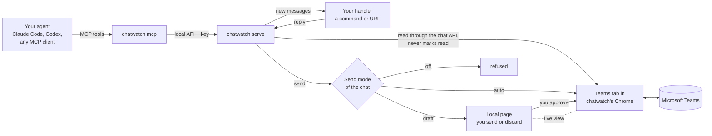

# chatwatch

English | [繁體中文](README.zh-TW.md)

Let AI agents read and answer your Microsoft Teams chats, through the Teams
web page you are already signed in to. No Azure app registration, no admin
consent, no bot account: chatwatch drives a Chrome tab with your own Teams
session.

- **Pull (MCP):** any MCP client (Claude Code, Codex, Cursor, …) gets tools to
  list chats, read messages, wait for new ones, fetch attachments and send.
- **Push (handlers):** each new batch of messages in a chat goes to a command
  or URL you choose; its answer is sent back to the chat.
- **You stay in control:** every chat has a send mode. `draft` (the default)
  keeps what an agent writes on the local page until you send or discard it;
  `auto` sends at once; `off` refuses.
- **Nothing is marked read by watching.** New messages are read through Teams'
  own chat service API from inside the tab, so chats stay unread. Sending opens
  the chat, which marks it read (Teams does that; it cannot be avoided).
- **See Teams on the page.** A live view of chatwatch's Chrome, also when it
  runs without a window: click, scroll and type in it to sign in again when
  Teams asks.
- **The Teams token never leaves the tab.** It is used inside the page and is
  never returned to Python, printed or saved.
- Python 3.9+ standard library only. Chrome, Chromium or Edge.


*The Teams tab, seen on chatwatch's local page (made-up chats).*

## How it fits together



An agent works with chats in one of two ways. Through **MCP** it asks for
chats and messages and sends when it decides to. Through a **handler** each
new batch of messages is pushed to it, and its answer is sent back. Either
way, every send passes the chat's send mode before anything reaches Teams.

## Quick start

```sh
git clone <this repo> chatwatch && cd chatwatch
pip install .                    # or run python3 -m chatwatch from this folder

# 1. Sign in to Teams once, in chatwatch's own Chrome profile
chatwatch browser --show         # sign in, then close the window

# 2. Run the watcher (starts Chrome headless) and open the page
chatwatch serve
chatwatch open                   # prints http://127.0.0.1:8766/#key=...

# 3. Give your agent the tools
claude mcp add teams -- chatwatch mcp
```

## The page

`chatwatch open` prints the page's address with its key; open it in your
browser. It refreshes itself every few seconds.

- **Pause / Resume** (top): the emergency stop, see [Push handlers](#push-handlers).
- **Teams screen:** see below.
- **Drafts:** every reply waiting for you. Edit the text, then **Send** or
  **Discard**. A draft whose earlier send may have gone out asks you to tick
  *I checked the chat* first, so nothing is sent twice by mistake.
- **Chats:** each chat Teams lists, with a dot when unread. Per chat:
  **Watch** (record its new messages and pass them on), **Send** (`draft`,
  `auto` or `off`; `auto` asks you to confirm) and **Handler** (where its new
  messages are pushed; handlers come from `config.json`).
- **Recent:** the last 30 events: new messages, sends, drafts, refusals and
  errors.


### Teams screen

On the page, **Show** under *Teams screen* displays what the Teams tab shows.
**Start operating** sends your clicks, scrolling and typing to it (on a phone,
use the text box and the Enter, ⌫ and Tab buttons); **Reload Teams** reloads
the tab. A send waits while you operate, and your input waits for a send in
progress. Only the Teams tab (or the Microsoft sign-in page it goes to) is
shown; there is no address bar.

## MCP tools

| Tool | What it does |
| --- | --- |
| `teams_list_chats` | Chats with title, id, preview, unread flag and their settings |
| `teams_read_messages` | Last n messages of a chat, without marking it read |
| `teams_wait_for_messages` | New incoming messages after an event number, waiting up to 60 s |
| `teams_send_message` | Text and files to a chat, under its send mode |
| `teams_get_attachments` | Download the pictures and files of given messages |
| `teams_list_drafts` | Replies waiting for you on the page |

`teams_send_message` answers with a status:

- `sent`: it is in the chat.
- `draft`: waiting for you on the page.
- `refused`: sending is off for this chat.
- `not_sent`: nothing went out; trying again is safe.
- `maybe_sent`: send was pressed but the message was not seen; do not resend
  before someone checks the chat.

A chat is named by its title, a part of the title that matches only one chat,
or its id.

## Push handlers

Define handlers in `~/.chatwatch/config.json` and pick one per chat on the
page:

```json
{
  "handlers": {
    "claude": {"command": ["claude", "-p", "--output-format", "text",
                "Answer this Teams chat. The messages are JSON on stdin."]},
    "my-bot": {"url": "http://127.0.0.1:9000/teams", "timeout": 300}
  }
}
```

A command gets the batch as JSON on stdin; a URL gets it POSTed:

```json
{"chat_id": "19:...", "chat": "Alice", "kind": "OneOnOneChat", "send": "draft",
 "messages": [{"mid": "...", "author": "Alice", "time": "...", "text": "Hi"}]}
```

It answers with plain text (the reply) or JSON `{"text": "...", "files":
["/abs/path"]}`. An empty answer sends nothing. The reply follows the chat's
send mode. In `auto`, a send that certainly did not go is tried again after
20 s, 60 s and 180 s, then kept as a draft; one that may have gone is kept as a
draft marked for checking, never resent by itself.

Two bots answering each other on `auto` never stop. Keep bot chats on `draft`.
**Pause** on the page is the emergency stop: nothing is read, queued handler
work is skipped, and while paused every `auto` chat behaves as `draft`. A
reply that comes back after its chat was paused, unwatched or given another
handler waits as a draft.

## Using it with an agent

With the MCP tools added, ask your agent in plain words, for example:

> Check my Teams chats for anything new from Alice and draft a reply.

> Wait for new Teams messages for the next 10 minutes and answer the
> questions about the shipping schedule.

The agent lists chats, reads, waits and sends with the tools above. On a
`draft` chat its replies wait on the page; switch a chat to `auto` only when
you trust what it sends there.

## Starting, stopping and signing in again

- `chatwatch serve` runs in the foreground; stop it with Ctrl+C. Chrome keeps
  running; `chatwatch browser stop` closes it.
- When Teams signs you out, reading stops with `NO_TEAMS_TOKEN`. Sign in again
  on the page's Teams screen, or close Chrome and run `chatwatch browser --show`.
- Settings, drafts and the sign-in stay in `~/.chatwatch` across restarts.
  Messages that arrived while chatwatch was stopped are passed on when it
  starts again (up to the last 20 per chat); those that arrived while it was
  paused are not, so no late automatic reply goes out after a pause.

## Troubleshooting

| Message | What to do |
| --- | --- |
| `chatwatch is not running at ...` | Start `chatwatch serve`. |
| `NO_TEAMS_TOKEN`, `CHAT_API_401` | Teams signed out: sign in again (above). |
| `Chrome not found` | Set `CHATWATCH_CHROME` to Chrome's executable. |
| `no chat matches` / `several chats match` | Use the exact title or the chat id from `teams_list_chats`. |
| `DRAFT_NOT_EMPTY` | Someone left text in that chat's message box; clear it on the Teams screen. |
| `CHAT_NOT_FOUND`, `NO_COMPOSE_BOX`, `NO_SEND_BUTTON` | Teams is still loading or its page changed; look at the Teams screen, then try again. |
| `TYPED_TEXT_MISMATCH`, `SEND_NOT_TAKEN` | Nothing was sent; trying again is safe. |
| `maybe_sent` | Look at the chat before sending again. |
| `the Teams tab is busy sending` | Your input on the Teams screen waited for a send; try again. |

## Command line

```
chatwatch chats
chatwatch read "Alice" 10
chatwatch send "Alice" "Hello" ./report.pdf     # sends now, whatever the mode: you are the person
chatwatch set "Alice" --watch on --send auto --handler claude
```

## Settings

| Variable | Default | |
| --- | --- | --- |
| `CHATWATCH_HOME` | `~/.chatwatch` | config, state, events, drafts, API key, Chrome profile |
| `CHATWATCH_PORT` | `8766` | page and local API |
| `CHATWATCH_CDP_PORT` | `9334` | DevTools port of chatwatch's Chrome |
| `CHATWATCH_CDP` | | use a Chrome you already run with `--remote-debugging-port` |
| `CHATWATCH_CHROME` | | path to the Chrome executable |
| `CHATWATCH_POLL` | `4` | seconds between checks |

## Security

The page and API listen on 127.0.0.1 only and need the key in
`~/.chatwatch/api-key`. Agents read what other people write to you, and in an
`auto` chat what they write goes out at once. Read [SECURITY.md](SECURITY.md)
before connecting an agent, and use it to report a problem.

## Limits

- Chats only, not channel posts.
- Chats are found among those Teams lists in its sidebar.
- Sending marks the chat read; watching does not.
- It depends on the Teams web page. When Teams changes it, reading or sending
  can stop until `teams.py` is updated; the error names the step that failed.

## How it works

`teams.py` reads through the chat service API inside the Teams tab and sends
by pasting the whole text into the compose box (a synthetic paste keeps line
breaks; typing key by key now and then lost a key), attaching files through
the file chooser, pressing send, and waiting for the message to appear.
`service.py` polls, records events, runs handlers and applies send modes.
`http_api.py` serves the page and the local API; `mcp.py` is a stdio MCP
server that talks to that API. `cdp.py` is a small DevTools client.

Teams changes its web page from time to time; the selectors in `teams.py`
then need updating.

## Tests

```sh
python3 -m unittest discover tests
```

See [CONTRIBUTING.md](CONTRIBUTING.md), [CHANGELOG.md](CHANGELOG.md) and
[docs/ROADMAP.md](docs/ROADMAP.md).

## License

MIT
