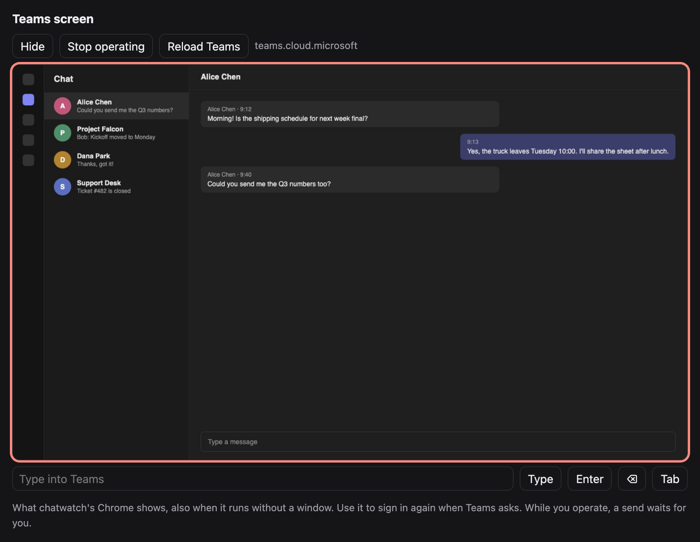
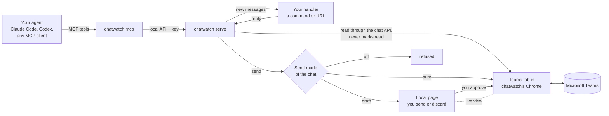
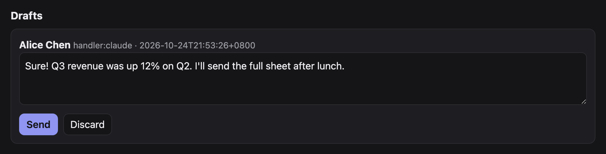
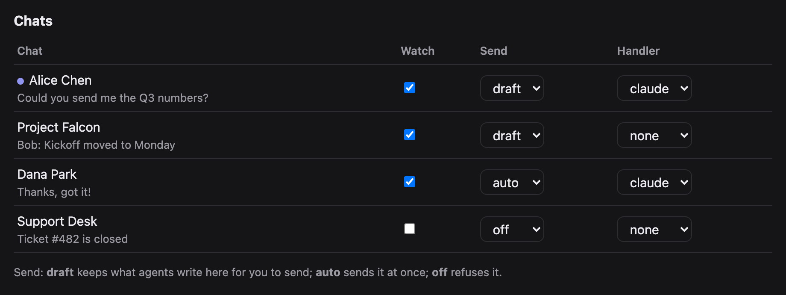

# chatwatch

[English](README.md) | 繁體中文

讓 AI agent 透過你已登入的 Teams 網頁版，讀取並回覆 Microsoft Teams 聊天。
不用註冊 Azure 應用程式、不用管理員同意、不用機器人帳號：chatwatch 用你自己的
Teams 登入，操作一個 Chrome 分頁。

- **主動讀（MCP）：** 任何支援 MCP 的 agent（Claude Code、Codex、Cursor…）都能
  列聊天室、讀訊息、等新訊息、下載附件、送訊息。
- **推送（handler）：** 聊天室有新訊息時，交給你指定的程式或網址，再把它的回覆送回去。
- **由你把關：** 每個聊天室有送出模式。`draft`（預設）把 agent 寫的內容留在本機頁面，
  等你送出或捨棄；`auto` 直接送；`off` 一律拒絕。
- **監看不會讓聊天室變已讀。** 新訊息是在分頁裡呼叫 Teams 自己的聊天 API 讀的。
  送訊息會打開聊天室，那時會變已讀（Teams 本身的行為，避免不了）。
- **在網頁上看 Teams。** chatwatch 的 Chrome 即使在無視窗模式下，也能在網頁上即時看到畫面，
  需要重新登入時可以直接點擊、捲動、打字。
- **Teams 的 token 不離開分頁。** 只在頁面裡使用，不回傳給 Python、不印出、不存檔。
- 只用 Python 3.9 以上的標準函式庫。需要 Chrome、Chromium 或 Edge。



*在 chatwatch 本機網頁上看到的 Teams 分頁（聊天內容為虛構）。*

## 架構



agent 有兩種方式處理聊天。透過 **MCP**，由它自己查聊天室、讀訊息，決定何時送出。透過 **handler**，
每批新訊息會推給它，它的回覆再送回去。不論哪種，每次送出都要先經過該聊天室的送出模式，才會到 Teams。

## 快速開始

```sh
git clone <this repo> chatwatch && cd chatwatch
pip install .                    # 或在這個資料夾裡用 python3 -m chatwatch

# 1. 在 chatwatch 自己的 Chrome 設定檔登入 Teams 一次
chatwatch browser --show         # 登入後關掉視窗

# 2. 啟動監看（Chrome 會以無視窗模式啟動），打開頁面
chatwatch serve
chatwatch open                   # 印出 http://127.0.0.1:8766/#key=...

# 3. 把工具接給 agent
claude mcp add teams -- chatwatch mcp
```

## 網頁

`chatwatch open` 會印出帶金鑰的網址，用瀏覽器打開即可；頁面每幾秒會自動更新。

- **Pause／Resume**（最上面）：緊急停止，見[推送 handler](#推送-handler)。
- **Teams screen：** 見下方。
- **Drafts（草稿）：** 所有等你處理的回覆。可以修改文字，再按 **Send** 送出或 **Discard** 捨棄。
  之前送出時「可能已送出」的草稿，要先勾「I checked the chat」（已確認聊天室）才能送，避免重複送。
- **Chats（聊天室）：** Teams 列出的每個聊天室，未讀的前面有圓點。每個聊天室可設定：
  **Watch**（記錄新訊息並往下傳）、**Send**（`draft`、`auto` 或 `off`；改成 `auto` 會先問你）、
  **Handler**（新訊息推給誰；handler 在 `config.json` 定義）。
- **Recent（最近紀錄）：** 最近 30 筆事件：新訊息、送出、草稿、拒絕、錯誤。





### Teams 即時畫面

網頁上「Teams screen」按 **Show** 就會顯示 Teams 分頁目前的畫面。按 **Start operating**
後，點擊、捲動、打字都會送進去（手機上用文字框和 Enter、⌫、Tab 按鈕）；**Reload Teams**
會重新整理分頁。你在操作時送訊息會等你，送訊息進行中你的輸入也會稍等。只顯示 Teams 分頁
（或它跳去的微軟登入頁），沒有網址列。

## MCP 工具

| 工具 | 用途 |
| --- | --- |
| `teams_list_chats` | 聊天室清單：名稱、id、最後一則預覽、未讀、設定 |
| `teams_read_messages` | 讀某聊天室最近 n 則，不會變已讀 |
| `teams_wait_for_messages` | 等某個事件編號之後的新訊息，最多等 60 秒 |
| `teams_send_message` | 送文字和檔案，依聊天室的送出模式 |
| `teams_get_attachments` | 下載指定訊息的圖片和檔案 |
| `teams_list_drafts` | 等你在頁面上處理的草稿 |

`teams_send_message` 回傳狀態：

- `sent`：已在聊天室裡。
- `draft`：在頁面上等你。
- `refused`：這個聊天室不允許送出。
- `not_sent`：確定沒送出，可以再試。
- `maybe_sent`：已按送出但沒看到訊息出現；有人確認聊天室之前不要重送。

聊天室可以用名稱、只對到一個聊天室的部分名稱，或 id 指定。

## 推送 handler

在 `~/.chatwatch/config.json` 定義 handler，再到頁面上替聊天室選一個：

```json
{
  "handlers": {
    "claude": {"command": ["claude", "-p", "--output-format", "text",
                "Answer this Teams chat. The messages are JSON on stdin."]},
    "my-bot": {"url": "http://127.0.0.1:9000/teams", "timeout": 300}
  }
}
```

指令從 stdin 收到 JSON；網址收到 POST：

```json
{"chat_id": "19:...", "chat": "Alice", "kind": "OneOnOneChat", "send": "draft",
 "messages": [{"mid": "...", "author": "Alice", "time": "...", "text": "Hi"}]}
```

回覆可以是純文字，或 JSON `{"text": "...", "files": ["/abs/path"]}`；空的就不送。
回覆依聊天室的送出模式處理。`auto` 下確定沒送出的，會在 20 秒、60 秒、180 秒後重試，
之後才留成草稿；可能已送出的會留成「需確認」的草稿，絕不自己重送。

兩個機器人在 `auto` 互相回覆會停不下來，機器人聊天室請維持 `draft`。
頁面上的 **暫停** 是緊急停止：不讀新訊息、略過排隊中的 handler 工作，暫停期間所有
`auto` 聊天室都當成 `draft`。handler 回來時若聊天室已暫停、取消監看或換了 handler，
回覆只會留成草稿。

## 搭配 agent 使用

加上 MCP 工具後，直接用平常的話請 agent 做事，例如：

> 看一下 Teams 裡 Alice 有沒有新訊息，幫我擬一則回覆。

> 接下來 10 分鐘等 Teams 新訊息，有人問出貨時程就回答。

agent 會用上面的工具列聊天室、讀、等、送。`draft` 聊天室裡它的回覆會停在網頁上等你；
確定信得過它在某個聊天室送的內容，再把那個聊天室改成 `auto`。

## 啟動、停止與重新登入

- `chatwatch serve` 在前景執行，按 Ctrl+C 停止。Chrome 會繼續開著；`chatwatch browser stop` 會關掉它。
- Teams 登出時，讀訊息會出現 `NO_TEAMS_TOKEN`。在網頁的 Teams 即時畫面重新登入，
  或關掉 Chrome 後執行 `chatwatch browser --show`。
- 設定、草稿和登入狀態都存在 `~/.chatwatch`，重新啟動後還在。chatwatch 停止期間收到的訊息，
  重新啟動後會補傳（每個聊天室最多最近 20 則）；暫停期間收到的不會補傳，避免暫停後才送出遲來的自動回覆。

## 常見問題

| 訊息 | 處理方式 |
| --- | --- |
| `chatwatch is not running at ...` | 先執行 `chatwatch serve`。 |
| `NO_TEAMS_TOKEN`、`CHAT_API_401` | Teams 登出了，重新登入（見上方）。 |
| `Chrome not found` | 把 `CHATWATCH_CHROME` 設成 Chrome 執行檔路徑。 |
| `no chat matches`／`several chats match` | 用完整名稱，或 `teams_list_chats` 給的聊天室 id。 |
| `DRAFT_NOT_EMPTY` | 那個聊天室的輸入框有人留了文字，在 Teams 即時畫面清掉。 |
| `CHAT_NOT_FOUND`、`NO_COMPOSE_BOX`、`NO_SEND_BUTTON` | Teams 還在載入或頁面改版；看一下 Teams 即時畫面再試。 |
| `TYPED_TEXT_MISMATCH`、`SEND_NOT_TAKEN` | 沒有送出，可以放心再試。 |
| `maybe_sent` | 先看聊天室，確認後再決定要不要重送。 |
| `the Teams tab is busy sending` | 你在即時畫面的操作在等一則訊息送完，稍後再試。 |

## 指令

```
chatwatch chats
chatwatch read "Alice" 10
chatwatch send "Alice" "Hello" ./report.pdf     # 立刻送出，不管送出模式：執行的人就是你
chatwatch set "Alice" --watch on --send auto --handler claude
```

## 設定

| 環境變數 | 預設 | |
| --- | --- | --- |
| `CHATWATCH_HOME` | `~/.chatwatch` | 設定、狀態、事件、草稿、API 金鑰、Chrome 設定檔 |
| `CHATWATCH_PORT` | `8766` | 頁面和本機 API |
| `CHATWATCH_CDP_PORT` | `9334` | chatwatch 的 Chrome DevTools 連接埠 |
| `CHATWATCH_CDP` | | 改用你已用 `--remote-debugging-port` 開著的 Chrome |
| `CHATWATCH_CHROME` | | Chrome 執行檔路徑 |
| `CHATWATCH_POLL` | `4` | 每次檢查間隔秒數 |

## 安全

頁面和 API 只聽 127.0.0.1，而且要 `~/.chatwatch/api-key` 裡的金鑰。agent 會讀到別人
寫給你的內容，`auto` 聊天室裡它寫的會立刻送出。接上 agent 前請先讀
[SECURITY.md](SECURITY.md)，回報問題也照那裡的方式。

## 限制

- 只有聊天，沒有頻道貼文。
- 只找得到 Teams 側邊欄列出的聊天室。
- 送訊息會讓聊天室變已讀；監看不會。
- 依賴 Teams 網頁版。Teams 改版時讀或送可能失效，要更新 `teams.py`；錯誤訊息會指出哪一步失敗。

## 運作方式

`teams.py` 在 Teams 分頁裡用聊天 API 讀訊息；送出時把整段文字貼進輸入框（模擬貼上會保留換行；
逐字打偶爾會掉字）、用檔案選擇器附檔、按送出，再等訊息出現。`service.py` 負責輪詢、記錄事件、
執行 handler、套用送出模式。`http_api.py` 提供頁面和本機 API；`mcp.py` 是走 stdio 的 MCP 伺服器，
透過那個 API 運作。`cdp.py` 是精簡的 DevTools 用戶端。

## 測試

```sh
python3 -m unittest discover tests
```

另見 [CONTRIBUTING.md](CONTRIBUTING.md)、[CHANGELOG.md](CHANGELOG.md)、[docs/ROADMAP.md](docs/ROADMAP.md)。

## 授權

MIT
